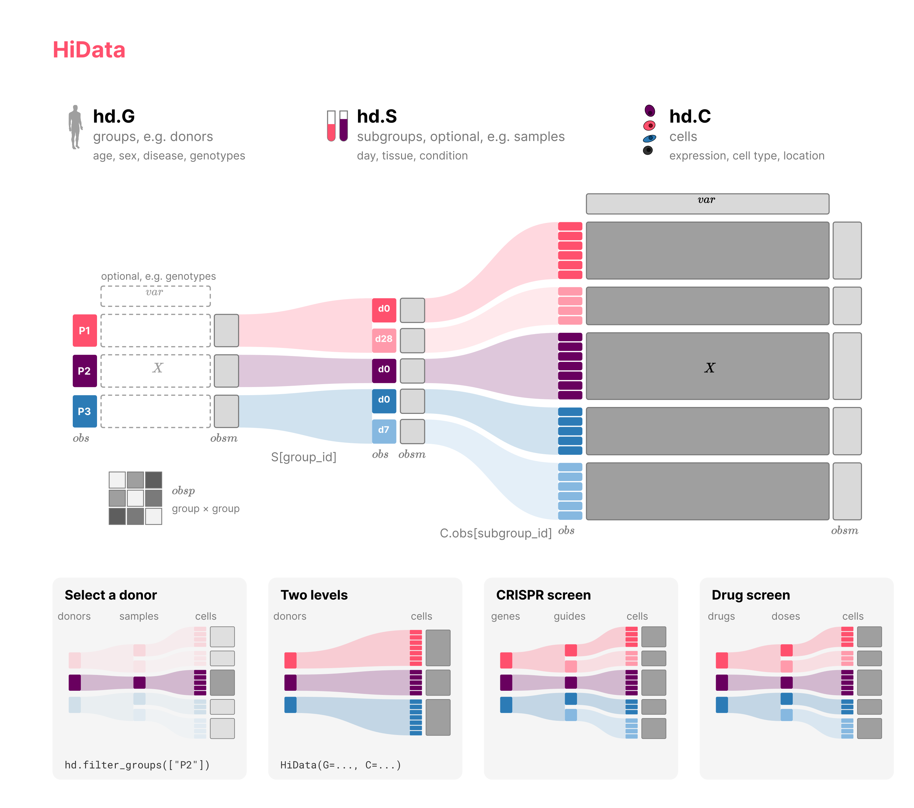

<!-- logo-image-start -->

<p align="center">
  
</p>

<br>

<!-- logo-image-end -->

[](https://github.com/theislab/hidata/actions/workflows/build.yaml)
[](https://opensource.org/licenses/Apache-2.0)
[](https://hidata.readthedocs.io/)
[](https://github.com/theislab/hidata/actions/workflows/test.yaml)
[](https://pypi.org/project/hidata)
[](https://github.com/pre-commit/pre-commit)

# HiData – hierarchical data

[Installation](https://hidata.readthedocs.io/en/latest/install.html) | [API](https://hidata.readthedocs.io/en/latest/api.html) | [Specification](https://hidata.readthedocs.io/en/latest/io/spec.html) | [Design](https://github.com/theislab/hidata/blob/main/DESIGN.md) |
[Changelog](https://hidata.readthedocs.io/en/latest/changelog.html)

In the same vein as AnnData is designed to represent annotated data and MuData multimodal data, HiData represents
hierarchical single-cell data: cells within optional subgroups within groups. A group is any unit that groups cells,
such as a donor, a patient, the target gene of a CRISPR screen or a compound, and a subgroup splits it further, such
as a sample, a time point, a guide or a dose.



## Data structure

```
HiData
  .G             groups, one row per group (a DataFrame of group labels, or AnnData, MuData, EHRData)
  .S             subgroups, one row per subgroup, optional (DataFrame, AnnData or EHRData)
  .C             cells (AnnData or MuData)
  .obsm          matrices aligned to the groups, such as embeddings or pseudobulk profiles
  .obsp          group by group matrices, such as distances
  .uns           unstructured annotations
```

`C.obs[group_id]` names the group of every cell. With a subgroup level, `C.obs[subgroup_id]` names the subgroup of
every cell and `S[group_id]` the group of every subgroup. Selecting units at one level selects the matching units at
the other levels, and matrices in `obsm` and `obsp` are subset with them.

## Overview

### Input

The most common input is an AnnData of cells whose `obs` repeats labels of their group, such as the disease or age of
a patient, on every cell. `from_anndata` moves the columns that are constant within groups into a group table, so `G`
is a DataFrame with one row per group and `C.obs` keeps the cell-level columns:

```python
from hidata import HiData

hd = HiData.from_anndata(adata, group_id="patient")
hd.G
```

A group table can also be passed directly. `G` is an AnnData only when groups have measurements of their own, such as
the genotypes of donors that [cellink](https://github.com/theislab/cellink) analyses:

```python
hd = HiData(G=patients, C=adata, group_id="patient")
```

With several samples per patient, `subgroup_id` adds the subgroup table `S`:

```python
hd = HiData.from_anndata(adata, group_id="patient", subgroup_id="sample")
```

### Selection and aggregation

```python
hd = hd.filter_groups("age > 60")
hd = hd.filter_groups_by_cells(20, groupby="cell_type", level="subgroup")
hd.get_df(["age", "timepoint", "CD14"], level="cell")
hd.composition("cell_type", level="subgroup")
profiles = hd.pseudobulk(groupby="cell_type", layer="counts", level="subgroup")
train, test = hd.train_test_split(0.2, stratify="disease")
```

### I/O with `.hd.h5` and `.hd.zarr` files

`HiData` objects are written to an HDF5 file or a Zarr store with one AnnData or MuData group per level, which can
also be read with anndata alone. Files and stores written by donordata are read as well.

```python
import hidata

hd.write_hd("cohort.hd.zarr")
hd = hidata.io.read_hd("cohort.hd.zarr")
```

## Installation

```console
pip install hidata
```

See the [installation guide](https://hidata.readthedocs.io/en/latest/install.html) for optional dependencies.

## Tutorials

The tutorials cover a [first object](https://hidata.readthedocs.io/en/latest/tutorials/getting_started.html), a
[patient cohort](https://hidata.readthedocs.io/en/latest/tutorials/patient_cohort.html), a [CRISPR screen](https://hidata.readthedocs.io/en/latest/tutorials/perturbation_screen.html),
[electronic health records](https://hidata.readthedocs.io/en/latest/tutorials/ehr_cohort.html) and
[multiple instance learning](https://hidata.readthedocs.io/en/latest/tutorials/mil_model.html) on the cells of each patient.

## Packages using HiData

[cellink](https://github.com/theislab/cellink) holds the genotypes of donors in `G` and runs single-cell genetics on
them, from eQTL mapping and rare variant tests to colocalization and LD score regression.
[patpy](https://github.com/lueckenlab/patpy) computes representations of patients or samples from their cells and
compares them across a cohort.

## Citation

If you use HiData, please cite it as described in [CITATION.cff](https://github.com/theislab/hidata/blob/main/CITATION.cff).
